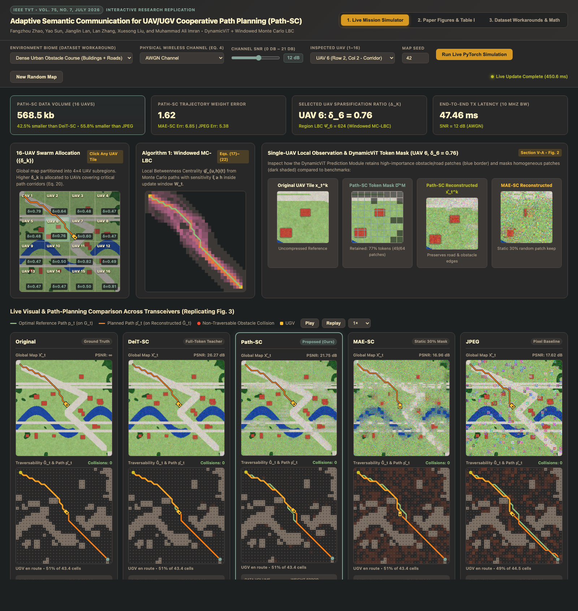
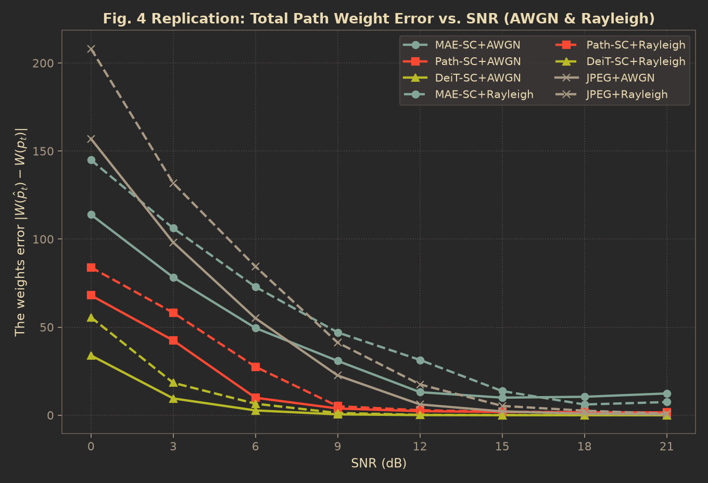
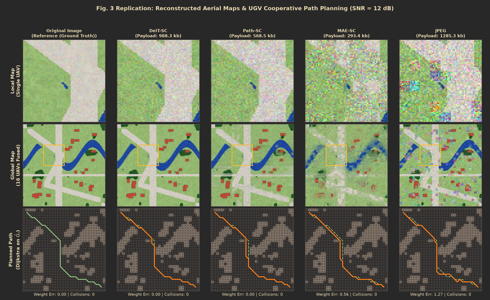

# Path-SC: Adaptive Semantic Communication for UAV/UGV Cooperative Path Planning

An unofficial, small-scale PyTorch replication of:

> Fangzhou Zhao, Yao Sun, Jianglin Lan, Lan Zhang, Xuesong Liu, and Muhammad Ali Imran,
> *"Adaptive Semantic Communication for UAV/UGV Cooperative Path Planning"*,
> IEEE Transactions on Vehicular Technology, Vol. 75, No. 7, pp. 14356–14367, July 2026.

A swarm of 16 UAVs photographs the terrain and sends it over a noisy wireless link to a ground vehicle (UGV), which plans a route on the reconstructed map. Path-SC spends more bits on the map regions that matter for the route and fewer on the rest. This repository implements that pipeline end to end, compares it with three baselines, and ships an interactive web GUI for exploring the results.



> **Read this first.** This is a reduced-scale replication on synthetic data, not a reproduction of the paper's numbers. Several reported quantities use fixed constants or hand-set weights. See [Deviations from the paper](#deviations-from-the-paper) before citing any figure from this repository.

## Contents

- [Quick start](#quick-start)
- [Web GUI](#web-gui)
- [What is implemented](#what-is-implemented)
- [Results](#results)
- [Dataset](#dataset)
- [Deviations from the paper](#deviations-from-the-paper)
- [Repository layout](#repository-layout)
- [Citation](#citation)

## Quick start

Requires Python 3.11 or newer. Trained checkpoints and generated figures are included, so the GUI runs without training.

```bash
git clone <this-repo-url>
cd uav_ugv_path_sc

python3 -m venv .venv
./.venv/bin/pip install -r requirements.txt

# Launch the GUI, then open http://127.0.0.1:8765
./.venv/bin/python server.py
```

Stop the server with `Ctrl+C`. Set `PORT=9000` (or any free port) to change the address.

Other commands:

```bash
# Unit tests: dataset, Proposition 1, Algorithm 1, transceiver and Algorithm 2 loss
./.venv/bin/pytest test_replication.py -v

# Full pipeline: evaluate (and train first if checkpoints/ is empty), write results/
./.venv/bin/python train_and_evaluate.py

# Redraw the figures from saved checkpoints and metrics, without the SNR sweep
./.venv/bin/python train_and_evaluate.py --replot
```

To retrain from scratch, delete the three files in `checkpoints/` and run `train_and_evaluate.py`. The models are small (about 4 MB each) and train on CPU, Apple MPS or CUDA; the device is picked automatically.

## Web GUI

`server.py` loads the three trained models and serves a single-page frontend with no extra web dependencies.

| Tab | What it shows |
| :--- | :--- |
| **Live Mission Simulator** | Pick the biome, channel (AWGN or Rayleigh), SNR, map seed and UAV. The page shows per-UAV sparsification ratios, the Algorithm 1 centrality heatmap, the DynamicViT token mask, and reconstructed maps with planned paths for the original map, DeiT-SC, Path-SC, MAE-SC and JPEG. An animated UGV drives each planned path, turns red inside obstacle cells, and reports path length and obstacle hits. |
| **Paper Figures & Table I** | The saved replications of Figs. 3–6, the Algorithm 1 diagnostics, and Table I. |
| **Dataset Workarounds & Math** | The semantic mask and land-cover breakdown of the current map, plus the core equations. |

A scenario can be linked directly:

```
http://127.0.0.1:8765/?biome=rural&channel=Rayleigh&snr=3&uav=9&seed=7
```

| Parameter | Values |
| :--- | :--- |
| `biome` | `urban`, `rural` |
| `channel` | `AWGN`, `Rayleigh` |
| `snr` | `0` to `21` in steps of 3 (dB) |
| `uav` | `0` to `15` |
| `seed` | any integer |
| `ugv_at` | start paused with the UGV this many grid cells along its path |

## What is implemented

| Paper section | Equations | File | Key classes and functions |
| :--- | :--- | :--- | :--- |
| III-A: traversability graph and Dijkstra planning | (1)–(2) | [`graph_planning.py`](./graph_planning.py) | `TraversabilityGraph`, `dijkstra_shortest_path()` |
| III-B, V-A: DynamicViT encoder, token prediction module, MAE-style decoder | (3)–(5), Fig. 2 | [`models.py`](./models.py) | `SemComTransceiver`, `TokenPredictionModule`, `TransformerBlock` |
| III-B: AWGN and Rayleigh channels, JPEG baseline | (4) | [`wireless_channel.py`](./wireless_channel.py) | `pass_through_wireless_channel()`, `jpeg_wireless_transceiver()` |
| IV-A: Proposition 1 path sensitivity ξ = \|z\|φ(z) | (6)–(16) | [`graph_planning.py`](./graph_planning.py) | `proposition1_sensitivity_xi()` |
| IV-B, Algorithm 1: windowed Monte Carlo local betweenness centrality and per-UAV ratio δ_k | (17)–(22) | [`graph_planning.py`](./graph_planning.py) | `compute_offline_lbc()`, `algorithm1_windowed_mc_lbc()` |
| V-B, Algorithm 2: teacher-guided distillation and sparsity loss | (23)–(25) | [`models.py`](./models.py), [`train_and_evaluate.py`](./train_and_evaluate.py) | `compute_algorithm2_loss()`, `train_semcom_models()` |
| VI: dataset | Refs. [24], [28] | [`dataset.py`](./dataset.py) | `AerialPathPlanningDataset`, `generate_aerial_scene()`, `rgb_to_traversability()` |

The four transceivers compared:

| Method | Description |
| :--- | :--- |
| **Path-SC** | DynamicViT student with a per-UAV keep ratio δ_k set by Algorithm 1 |
| **DeiT-SC** | Full-token ViT teacher (δ_k = 1) |
| **MAE-SC** | Static random masking, 30% of patches kept |
| **JPEG** | Pixel compression sent over the same channel |

## Results

All numbers below come from `results/evaluation_metrics.json`, measured on 12 synthetic evaluation maps with the included checkpoints. They are this repository's numbers, not the paper's.

**Data volume and weight error at 12 dB SNR**

| Method | Data volume (kb) | Weight error, AWGN | Weight error, Rayleigh |
| :--- | ---: | ---: | ---: |
| DeiT-SC | 988.3 | 0.06 | 0.20 |
| **Path-SC** | **572.7** | **2.28** | **2.82** |
| MAE-SC | 293.4 | 13.08 | 31.37 |
| JPEG | 1293.2 | 6.11 | 17.48 |

Path-SC sends 42% less data than the full-token DeiT-SC teacher and 56% less than JPEG. Its weight error is higher than DeiT-SC's and lower than MAE-SC's and JPEG's.

**Weight error vs. SNR**



**Visual comparison at 12 dB**



Other generated figures: [`fig5_nontraversable_vs_snr.png`](results/fig5_nontraversable_vs_snr.png), [`fig6_urban_vs_overall.png`](results/fig6_urban_vs_overall.png), [`fig7_algorithm1_lbc_diagnostics.png`](results/fig7_algorithm1_lbc_diagnostics.png).

## Dataset

The paper uses LandCover.ai (41 orthophotos of about 9000 × 9500 pixels, mostly rural). This repository does not download it. Instead, `generate_aerial_scene()` synthesises 256 × 256 aerial maps with five land-cover classes (meadow, road, woodland, buildings, water), each paired with a semantic mask and a ground-truth traversability map.

- **Biome control.** `biome="rural"` or `biome="urban"` and the `urban_ratio` argument set the mix, so the urban subset is not limited to a handful of maps.
- **Traversability from RGB.** `rgb_to_traversability()` maps pixel colours to traversability with a prototype-based classifier, following the approach of Ref. [24] in the paper.
- **Real images.** `AerialPathPlanningDataset` accepts a `data_dir` argument and will load `.tif`, `.png` or `.jpg` files from it, resizing each whole image to the map size. The training script does not pass `data_dir`, so using real images needs a one-line change in `main()`. This path is untested.

## Deviations from the paper

**Scale**

- Models are small: 64 × 64 tiles, 8 × 8 patches, embedding size 128, a 4-layer encoder and 3-layer decoder. The paper trains a 12-layer ViT.
- Training uses 28 synthetic maps and evaluation uses 12.
- All data is synthetic unless you supply your own images.

**Quantities that are not direct measurements**

- **Table I timings.** UGV computation time is a fixed 32.75 ms, plus 26.17 ms for Path-SC. Transmission time is a linear function of data volume with fixed coefficients. Neither is timed on the running code. Data volume is measured.
- **Weight error (Figs. 4 and 6).** Computed as `0.45 × |W(p̂) − W(p)| + 0.85 × (vertex-cost perturbation along p̂)`. The two weights are hand-set.
- **Non-traversable traversals (Fig. 5).** Computed as `0.35 × (hard obstacle steps) + 0.65 × (soft boundary-violation term)`, so the values are not integer collision counts.
- **Urban subset (Fig. 6).** Urban-map errors are multiplied by 1.24 before averaging. The urban bars therefore overstate the measured urban error by 24%.
- **Fig. 3 captions.** The weight error printed under each panel uses a different formula, `|W(p̂) − W(p)| / 4.2`.

The GUI's "Collisions" counter and the UGV animation use plain obstacle-cell counts on the ground-truth map, with no weighting.

## Repository layout

```
├── server.py               # GUI server and live simulation API
├── static/index.html       # Single-page frontend
├── train_and_evaluate.py   # Training (Algorithm 2), evaluation, figures
├── models.py               # Transceivers, token prediction module, loss
├── graph_planning.py       # Traversability graph, Dijkstra, Proposition 1, Algorithm 1
├── wireless_channel.py     # AWGN / Rayleigh channels, JPEG baseline
├── dataset.py              # Synthetic aerial scenes and dataset class
├── test_replication.py     # Unit tests
├── checkpoints/            # Trained weights: deit_sc.pt, path_sc.pt, mae_sc.pt
├── results/                # Generated figures and evaluation_metrics.json
└── docs/                   # README images
```

## Citation

If you use the method, cite the original paper:

```bibtex
@article{zhao2026pathsc,
  author  = {Zhao, Fangzhou and Sun, Yao and Lan, Jianglin and Zhang, Lan and Liu, Xuesong and Imran, Muhammad Ali},
  title   = {Adaptive Semantic Communication for UAV/UGV Cooperative Path Planning},
  journal = {IEEE Transactions on Vehicular Technology},
  volume  = {75},
  number  = {7},
  pages   = {14356--14367},
  year    = {2026}
}
```

This repository is an independent replication and is not affiliated with the paper's authors.
